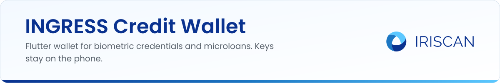
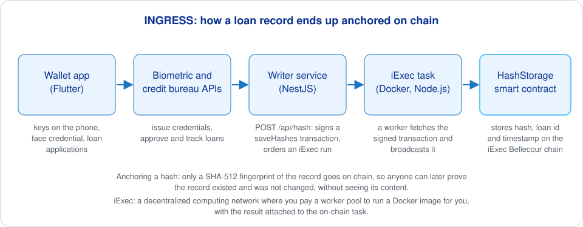

# INGRESS Credit Wallet

The mobile app of INGRESS, an Iriscan project from the EU NGI ONTOCHAIN program: biometric credentials and verifiable credit histories for microlending. A person generates a key pair on their phone, takes a face photo to receive a biometric credential from the Biometric Bureau, and uses it to apply for loans from the Credit Bureau's offers and follow their status. The app is written in Flutter and runs on Android and iOS.



Anchoring a hash means writing only a fingerprint of a record (here SHA-512) to the chain: anyone can later check that a record existed at a given time and was not altered, while the record itself stays private. iExec is a decentralized computing network: you pay a worker pool to run a Docker image for you, and the result is tied to an on-chain task.

## What it does

- Register: enter your details, generate a public and private key on the device, and register the public key with the Credit Bureau. If your old keys were lost or compromised, you can enter the old data to link the new keys to the same account.
- Login: unlock the wallet with the phone's own biometrics or passcode (`local_auth`); keys, session token and personal data stay in the platform secure storage (`flutter_secure_storage`).
- Credentials tab: take a face photo and send it, with your keys, to the Biometric Bureau (`POST /v1/users/auth/register`); the returned credential is kept on the device.
- Applications tab: pick a loan offer from the Credit Bureau and submit an application (`POST /v1/user/loan-applications`); a bureau manager then verifies you in person.
- Loans tab: list your loans and their status.

Screens live in `lib/pages/`, the HTTP clients in `lib/service/`, and the routes in `lib/routes.dart`. The step-by-step user guide with screenshots is on the [project site](https://github.com/biometric-technologies/ingress-site) under "Mobile Wallet".

## How to build

You need Flutter with a Dart SDK in the `>=2.19.6 <3.0.0` range (see `pubspec.yaml`), plus the Android SDK and/or Xcode.

1. `flutter pub get`
2. Point the app at your bureau services in `lib/constants.dart`:
   ```dart
   static const BIOMETRIC_BUREAU_URL = 'https://api.biometric-bureau.example.org';
   static const CREDIT_BUREAU_URL = 'https://api.credit-bureau.example.org';
   ```
3. `flutter run`, or `flutter build apk --debug` for an installable Android build.
4. For signed release builds follow the Flutter guides for [Android](https://docs.flutter.dev/deployment/android) and [iOS](https://docs.flutter.dev/deployment/ios).

A GitHub Actions workflow in `.github/workflows/build-and-release.yml` builds releases.

## Related repositories

- [ontochain-iexec-writer](https://github.com/biometric-technologies/ontochain-iexec-writer): the service that anchors loan-record hashes on chain through iExec.
- [ontochain-iexec-task](https://github.com/biometric-technologies/ontochain-iexec-task) and [ontochain-iexec-smartcontract](https://github.com/biometric-technologies/ontochain-iexec-smartcontract): the iExec task and the `HashStorage` contract.
- [ingress-site](https://github.com/biometric-technologies/ingress-site): project website with user guides for the wallet and the bureau back offices.
- [biometric-sdk](https://github.com/biometric-technologies/biometric-sdk): Iriscan's open-source face and iris recognition SDK.

## License

License: not yet specified.

## Contact

info@iriscan.com, https://www.iriscan.com
